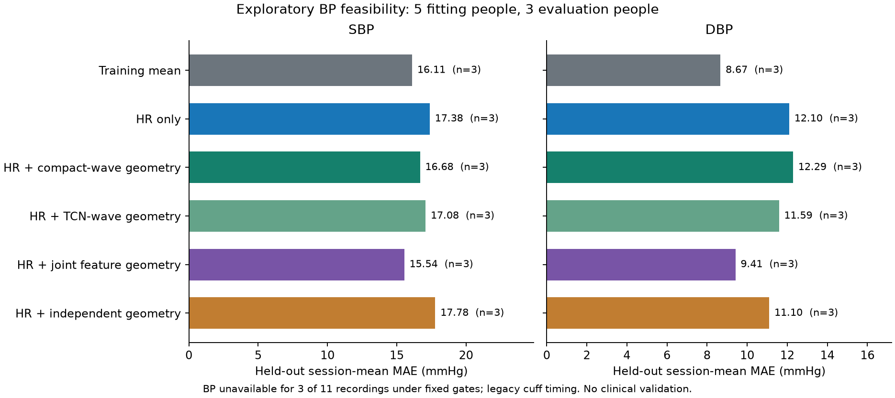

# Pilot11: frozen model transfer, timing and BP feasibility

Study started 2026-11-08; report completed 2026-11-09. **The current models do not provide reliable BP
estimates on this pilot, and repeatable face–hand timing is not established.**
All eleven recordings were evaluated. Signal eligibility reduced the planned
six-development/five-evaluation BP split to **five fitting and three evaluation
people**. The other three people remain in acquisition and failure denominators;
their missing physiological features are not counted as successful predictions.

The [fixed protocol](PILOT11_NEW_MODELS_PROTOCOL.md),
[model/scope lock](waveform_research/pilot11_model_and_scope_lock_20261108.json),
[aggregate results](waveform_research/pilot11_evaluation_20261108.json) and
[clock controls](waveform_research/pilot11_clock_controls_20261108.json) contain
the design and machine-readable evidence. No BP-based model/seed selection,
waveform fine-tuning or threshold relaxation followed the readout.

## What was actually used

- The named current final workbook was copied exactly and checksummed. Eleven
  consenting sessions matched eleven explicit video filenames; 33 numeric cuff
  pairs and zero manual exclusions were found. Original cells/formulas/caches
  remain unchanged. Snapshot SHA-256 is recorded in the aggregate receipt.
- All eleven videos were re-extracted consistently: **198,513 frames,
  3,314.975 seconds**, native pixels, every frame, original MP4 presentation
  timestamps, identical Tasks face/hand landmarkers and model assets. None of
  the six legacy caches was mixed into the primary experiment.
- All **15 frozen checkpoints** ran at both 30 and 60 Hz: compact real-only and
  mixed robust TCN waveform families, plus independent, joint and shared-head
  feature systems, each at three fixed seeds. Facial models received matching
  forehead/cheek inputs. No hand was substituted for facial training inputs.
- There were **329 nonoverlapping facial model windows at each rate**. At 30 Hz,
  106 were candidate cuff-free windows; 26 also passed facial quality gates,
  across eight people. These eight provided five fitting and three evaluation
  vectors. The baseline comparisons use the same eligible people.

The models reconstruct waveforms or predict contact-derived feature summaries;
they do not directly output BP. The BP experiment fitted six fixed small
regressions from recording-level features, with ridge alpha 10, training-only
imputation/scaling and three-seed feature averages. Each person's three cuff
readings were averaged into **one** target. Five fitting vectors therefore use
15 cuff readings; three evaluation targets use nine readings. Video windows
were not replicated into independent cuff-labelled examples.

All 33 cuff events retain legacy timing-source labels. **None** is marked as
reviewed against the video. Event-level accuracy and a timing contribution to
BP are therefore unavailable. The session-mean BP comparison below is explicitly
exploratory. The three unavailable participants were excluded by predeclared
signal rules, not by their pressure values or prediction errors.

## BP results

Errors are MAE in mmHg. Development leave-one-person-out refits every transform
inside its fold. Final predictions were saved before scoring evaluation BP.

| Fixed comparator | Development SBP / DBP, n=5 | Evaluation SBP / DBP, n=3 |
|---|---:|---:|
| Training mean | 7.33 / 7.00 | **16.11 / 8.67** |
| Face GREEN HR only | 8.28 / 6.48 | 17.38 / 12.10 |
| HR + compact-wave geometry | 9.39 / 7.34 | 16.68 / 12.29 |
| HR + TCN-wave geometry | 10.53 / 6.23 | 17.08 / 11.59 |
| HR + joint feature geometry | 9.29 / 7.12 | **15.54 / 9.41** |
| HR + independent feature geometry | 7.80 / 6.21 | **17.78 / 11.10** |



The joint system's observed SBP MAE improvement over the mean is only 0.57 mmHg,
with a descriptive person-bootstrap interval of [-0.88, 2.40]. Its DBP MAE is
0.75 mmHg worse, with an improvement interval of [-2.70, 1.89]. Independent
experts are worse than the mean for both targets. Improving on the weak HR-only
baseline does not establish useful BP information when the training mean is
stronger. No variant consistently improves both pressures over that mean.

Errors also have substantial underprediction: joint SBP bias is -15.00 mmHg,
and SBP RMSE is 25.73 mmHg, versus 25.31 for the mean. Complete bias/RMSE and all
paired comparisons remain in the aggregate JSON. With three evaluation people,
bootstrap intervals are descriptive and do not characterize population
performance or uncertainty from fitting on only five people. No clinical
accuracy claim, BP-based waveform selection or deployment follows.

These data can support small exploratory regressions and failure analysis.
They do not presently support training and validating a reliable large BP
network. Additional waveform complexity has not solved the field-data problem.

## Timing results

Primary timing uses matched native-rate combined-face/palm GREEN processing,
five-second cuff guards and disjoint ten-second windows. Positive offset means
hand lags face. Its scheduling differs from the facial model's global schedule;
the timing denominator of 108 and facial cuff-free denominator of 106 are
different prespecified sets of windows.

| Cuff guard | Independent candidate windows | Computable offsets | Strict windows |
|---|---:|---:|---:|
| 0 seconds | 132 | 111 | 0 |
| 5 seconds, primary | **108** | **93** | **1** |
| 10 seconds | 69 | 57 | 0 |

**No person has two strict independent windows.** The minimum within-record
repeatability criterion is unmet; repeat-session physiological timing is also
unvalidated. No candidate interval has verified cuff-free timing.

The median of person-median computable correlation offsets is -3.43 ms. This is
an algorithm output, not a measured physiological lead. Corresponding
person-median split-half and phase/correlation differences are approximately
46.45 and 46.00 ms. Low coherence affects 88/108 attempts; face-quality concerns
affect 93/108 and hand-quality concerns 66/108. Reasons overlap.

Unconfirmed agreement must not be confused with measured disagreement. Method
agreement is unavailable in 106/108 attempts because enough good paired
waveforms are absent; only two have a measured method range. ROI agreement is
unavailable in 103/108. The median same-window cross-model lag range is 43.68 ms
in the learned-face/classical-palm sensitivity, across computable windows and
all phases. Different processing can move an estimated offset substantially.
These learned models have no validated hand-domain timing counterpart.

The 25,740 generated-signal controls recover known matched-shape delays with
about 1.10-ms MAE on actual camera-clock slices. The prescribed morphology
change increases this to 12.39 ms; known long-gap windows abstain. These are
synthetic signals on 18-second clock slices, not camera exposure calibration or
eleven biological timing validations. Sample spacing is not an absolute
sub-frame estimation limit. Unknown rolling shutter, exposure timing and
fiducial differences still leave the physical uncertainty unbounded.

Current offsets are useful engineering diagnostics. They are not qualified
PTT/PAT, PWV or a timing feature for BP prediction.

## What 60 fps and the waveform models establish

The original clips have median presentation cadence near 60 fps and no exact
adjacent decoded duplicate frames. This does not certify independent sensor
exposures, absence of camera processing or row timing.

Both numerical paths produce finite outputs. At 30 Hz, 316/329 windows are
nonflat; at 60 Hz, 329/329 are. Zeroed outputs are pipeline abstentions. The
paths have different anti-alias/gap-support behavior, documented in the
protocol, so this is not an isolated FPS improvement. Candidate cuff-free
quality-qualified counts are 26 and 28, respectively.

On the 26 primary quality-qualified paired windows, subject-median 30/60
same-clock correlations are about .998 and relative lags about 0.33–0.51 ms.
This shows numerical consistency. There is no simultaneous contact waveform
here to score reconstruction accuracy, pulse-foot timing or extra fine detail.
In the six learned native-60 outputs, subject-median power above 15 Hz remains
below 0.04% of analyzed power; any such content is unvalidated.

Thus, higher FPS has not yet produced demonstrated additional physiological
detail in these frozen models. All weights were learned from 30-Hz targets.
Interpolating those targets or generating more output samples cannot establish
new ground truth. Native-60 paired RGB/reference data remain the appropriate
route for the requested high-rate training experiment.

## Decision and next permitted work

1. Preserve every result and retained checkpoint. Keep the prior waveform
   candidate and frozen V1; do not select a new primary using these BP errors.
   Independent specialization remains a hypothesis without a consistent gain.
2. Prioritize signal/reference quality and generalization over another large
   BP or architecture search on these eleven people. The current observations
   do not isolate camera angle as the cause, nor establish that recollecting
   the entire cohort would solve the problem.
3. Review actual cuff intervals in the existing recordings before event-level
   BP analysis. A local BP-blinded queue contains all 33 events without BP
   values. Audio/video cues, if identifiable, require actual review; no source
   label is automatically promoted to verified.
4. Use the existing [phone-only control design](PHONE_CAMERA_FEASIBILITY_PLAN.md)
   before proposing participant retakes. Bound exposure/row effects where
   possible and check pulse-band illumination, ROI support and repeatability.
   Phone-only tests may diagnose artifacts without identifying physiology.
5. Continue the already selected waveform research route while native-60
   dataset access is pursued. New admitted data must bring paired reference,
   clock documentation and a new grouped evaluation, rather than another
   tuning cycle on this consumed cohort.

No new equipment purchase, private-data upload, production replacement or main
merge is proposed. The user's existing phones/cuff decision remains in force.

The local review file is
`outputs/pilot11_new_models/20261108_01/cuff_review/private_blinded_review_queue.json`.
All eleven original files have audio tracks, but pump sounds have not been
identified. Review the original video/audio around each suggested range without
consulting BP values or model errors. Record actual endpoints and the supporting
cue in a separate correction record; retain unknown endpoints when the cue
cannot be established. Do not change a legacy label solely to make an event
eligible. Any corrected-timeline rerun remains a sensitivity on consumed data,
and preserves the original locked result above.

## Integrity and reproduction

Independent sklearn imputation/scaling/SVD-ridge replay reproduces **180 saved
numbers**, with maximum difference 1.42e-14. All **121** evaluation artifacts,
**15** retained checkpoints and **three** prior frozen/candidate artifacts pass
hash checks. This is software validation, not extra participants or physiology.
The implementation also passes synthetic CI at
[`e474319`](https://github.com/MahdiS3171/rPPG-Estimation-for-BPM-and-BP/actions/runs/42518433848).

Original videos/workbook, historical caches/results, frozen V1 and previous
candidate bytes are preserved. Private traces, reference values, predictions,
fits and review queue stay under ignored
`outputs/pilot11_new_models/20261108_01/`. Public Git contains aggregate evidence
and source only. All eleven are now consumed for this explicitly authorized
study; S007–S011 cannot be described as untouched again.

From the repository root, the executed stages are:

```powershell
.venv\Scripts\python.exe -m scripts.acquire_pilot11_native --run outputs/pilot11_new_models/20261108_01 --workers 3
.venv\Scripts\python.exe -m scripts.evaluate_pilot11_new_models --run outputs/pilot11_new_models/20261108_01 --watch
.venv\Scripts\python.exe -m scripts.evaluate_pilot11_bp --run outputs/pilot11_new_models/20261108_01
.venv\Scripts\python.exe -m scripts.verify_pilot11_results --run outputs/pilot11_new_models/20261108_01
.venv\Scripts\python.exe -m scripts.audit_pilot11_native_outputs --run outputs/pilot11_new_models/20261108_01
.venv\Scripts\python.exe -m scripts.summarize_pilot11_evaluation --run outputs/pilot11_new_models/20261108_01 --output docs/waveform_research/pilot11_evaluation_20261108.json
.venv\Scripts\python.exe -m scripts.prepare_pilot11_cuff_review --run outputs/pilot11_new_models/20261108_01
```

Do not rerun acquisition over completed data without explicit resume; cached
evaluations verify identities. Prediction locks reject different predictions.
The numerical verifier does not repeat neural inference or waveform training.
