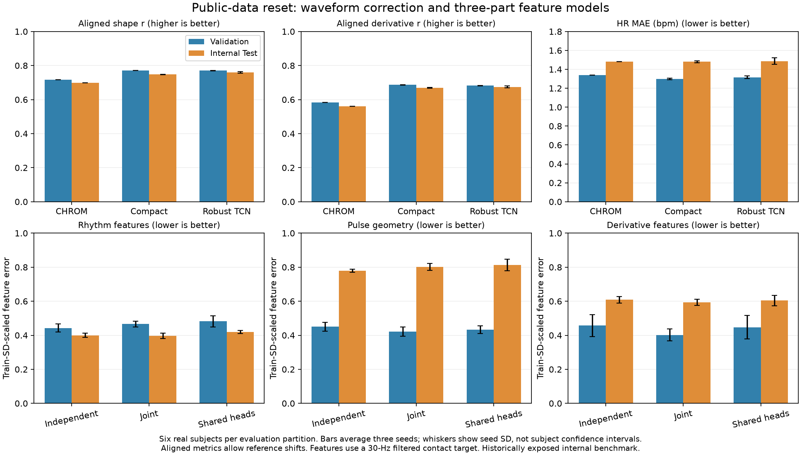

# Public-data reset: waveform and three-part model results

Updated 2026-11-08. This user-authorized benchmark uses all 41 eligible UBFC
participants and ten admitted SCAMPS clips, assigned once to subject/clip roles.
It is historically exposed internal evidence, not a new external cohort.
Historical V1/splits/results and the prior candidate checkpoint are preserved.

## Data and completed validation comparisons

| Role | Real people | Synthetic clips | Ten-second windows |
|---|---:|---:|---:|
| Train | 29 | 8 | 846 (830 real, 16 synthetic) |
| Validation | 6 | 1 | 173 (171 real, 2 synthetic) |
| Test | 6 | 1 | 181 (179 real, 2 synthetic) |

All roles are disjoint by person/clip; zero exclusions and zero exact input
duplicates cross roles. UBFC's two-second stride supplies more overlapping
contexts, not more independent people. Models receive ROI RGB/classical traces,
not every video pixel. All targets remain 30 Hz. The admitted SCAMPS subset is
ten clips, not the full public release; avatar identity independence is unknown.

All 132 waveform fits completed in 418.95 local seconds: 40 mechanisms at three
seeds (120 fits), plus 12 same-Validation data-volume controls. All weights start
fresh. Full tables include weak variants and shuffled-label controls. Nine
feature-system fits completed in 59.79 seconds. No checkpoint was chosen from
intermediate validation peaks; fixed final steps are used throughout.

## Waveform results on the new real Validation group

Values below average windows within people, then the six people; learned rows
then average the three seeds. These cannot be directly compared with the old
26-person OOF numbers to infer a data-size effect: the evaluation population,
window stride and some training budgets changed.

| Method | Native r | Aligned shape r | Aligned d1 r | HR MAE, bpm |
|---|---:|---:|---:|---:|
| Fixed CHROM_WIN | .097 | .717 | .583 | 1.339 |
| Compact morphology, real-only training | .193 | .771 | .687 | 1.297 |
| TCN, ROI dropout/consistency, 20% synthetic | .196 | .770 | .682 | 1.316 |
| Attention, morphology, 20% synthetic | .192 | .774 | .676 | 2.526 |

The real-only compact model has the highest mean combined aligned shape/d1
score among eligible models; the mixed TCN remains close and is retained as a
prespecified comparator. Attention's shape score does not compensate for its
higher HR error. Native reference correlation remains much weaker than aligned
shape. Alignment searches +/-0.5 seconds; it does not qualify local timing.
One synthetic validation clip is an engineering diagnostic, not a second real
population. Source-specific metrics are retained in the machine tables.

## Did more training data help?

Matched checks use the SAME new Validation group, the first two common seeds,
all eight synthetic training clips and identical optimization steps:

| Model | Real Train scope | Native r | Shape r | d1 r | HR MAE |
|---|---|---:|---:|---:|---:|
| Compact morphology | 21 people, dense | .180 | .753 | .665 | 1.339 |
| Compact morphology | 29 people, dense | .193 | .761 | .679 | 1.325 |
| Compact morphology | 29 people, nonoverlap | .188 | .756 | .669 | 1.319 |
| Raw temporal/native | 21 people, dense | .151 | .651 | .508 | 2.316 |
| Raw temporal/native | 29 people, dense | .158 | .659 | .532 | 2.839 |
| Raw temporal/native | 29 people, nonoverlap | .155 | .669 | .537 | 2.315 |
| TCN consistency | 21 people, dense | .202 | .772 | .684 | 1.313 |
| TCN consistency | 29 people, dense | .192 | .770 | .683 | 1.315 |
| TCN consistency | 29 people, nonoverlap | .173 | .764 | .674 | 1.489 |

Additional participants slightly help the compact model, but do not improve
every endpoint or architecture. Overlap helps the TCN in these runs and does
not uniformly help the raw model. Two seeds/six validation people limit strong
inference; these data do not support a blanket more-data improvement claim.

## Three-part feature model

The [fixed specialist protocol](THREE_PART_FEATURE_PROTOCOL.md) defines ten
contact-derived rhythm, pulse-geometry and derivative features. Compare fully
independent experts with one joint network and one shared encoder/three heads.
Capacities are 35,274 / 34,858 / 35,766 parameters respectively. Independent
experts share no parameters and receive no gradients from other task groups,
verified by synthetic gradient tests. Feature normalization uses Train only.
This first comparison uses common batches, an AdamW schedule and global gradient
clipping; optimizer state is per parameter, but the clipping scale can couple
update magnitudes. It does not test task-specific architectures, learning-rate
schedules or separate clipping budgets. Conclusions apply to this condition.

Lower scaled feature error is better; values average the same six validation
people and three seeds. Scaling uses training feature SD with fixed floors.
It permits within-feature comparisons, not a clinical interpretation.

| Method | Rhythm error | Geometry error | Derivative error | HR MAE, bpm |
|---|---:|---:|---:|---:|
| Train mean | .984 | .563 | .951 | 21.401 |
| Input-feature ridge | .556 | .504 | .574 | 7.311 |
| Features from TCN consistency waveform | .456 | .597 | .711 | 1.426 |
| Three independent experts | .443 | .450 | .457 | 6.061 |
| Joint feature network | .466 | .422 | .402 | 6.596 |
| Shared encoder, three heads | .482 | .433 | .447 | 6.766 |

Direct feature prediction improves geometry/derivative estimates relative to
extracting those summaries from the reconstructed waveform. Fully independent
experts do not consistently beat a matched joint learner. Their small rhythm
advantage does not imply better HR than the waveform: the rhythm group also
contains interval and interval-variability summaries. All direct neural HR
estimates are substantially worse than the waveform HR on Validation.

Consequently retain the three-part implementation and its negative results,
but do not declare it a superior waveform reconstruction model. It returns a
feature vector; it does not yet form one integrable waveform. A few invalid
physical feature predictions are counted, not clipped away. Pulse features are
computed from a declared filtered contact reference at 30 Hz; they are not
verified facial fiducials, clinical HRV, precise face-hand delay or BP labels.

## Verification and locked internal Test

Independent saved-value replay reproduced 14,958 waveform values (including
per-person/source aggregates) and checked all 132 checkpoint hashes; maximum
metric difference 1.28e-7. Feature replay reproduced 2,400 values exactly,
verified Train-only scaling and checked nine more checkpoint hashes. No neural
execution or Test access occurred in those replays.

The [selection manifest](waveform_research/reset_internal_test_selection_20261108.json)
locked the real-only waveform leader, prespecified mixed TCN comparator,
all fixed waveform controls and all three feature-system modes/seeds. Selection
uses Validation only: waveform mean (shape+d1)/2 with complete finite coverage
and HR no more than CHROM +0.5 bpm; feature preference uses mean group scaled
error. Report all locked Test comparators without subsequent Test-based tuning.
The test consumption receipt was created before opening Test arrays. The
evaluator refuses a second independent consumption under a new output name.
All 19 waveform and 19 feature comparators completed without neural fitting or
Test-based tuning. Previous dataset/architecture exposure remains acknowledged.

Internal Test results below average the six real people, then the three seeds:

| Fixed Test comparison | Native r | Shape r | d1 r | HR MAE, bpm |
|---|---:|---:|---:|---:|
| CHROM_WIN | .187 | .699 | .561 | 1.481 |
| Compact real-only, Validation-selected primary | .267 | .748 | .669 | 1.480 |
| Mixed robust TCN, prespecified comparator | .262 | .760 | .675 | 1.487 |

Waveform shape/derivative gains repeat, with little HR change. The TCN's higher
Test shape score does not retrospectively change the Validation-selected primary.
Native reference agreement remains weak and is not local arrival-time truth.

| Feature Test comparison | Rhythm error | Geometry error | Derivative error | HR MAE, bpm |
|---|---:|---:|---:|---:|
| Train mean | .909 | .806 | .859 | — |
| Input-feature ridge | .499 | .829 | .674 | — |
| Independent experts | .399 | .780 | .609 | 4.063 |
| Joint, Validation-preferred feature mode | .396 | .801 | .594 | 4.567 |
| Shared encoder/heads | .419 | .813 | .604 | 4.999 |

The independent system has no consistent overall advantage. Test geometry is
near the constant baseline for every direct neural mode; its attractive
Validation scores did not transfer well. Derivative summaries improve relative
to the constant baseline, but direct HR remains worse than waveform HR. These
results do not support replacing the waveform model with independent feature
experts or using the features for BP. They also do not prove specialization can
never help: this is one small dataset, target definition and training budget.

Source-specific failures remain visible. On the single synthetic Test clip,
fixed CHROM HR error is 41.327 bpm despite native r .753; quality-weighted fusion
has .194-bpm HR error. Both learned waveform families have about .8-bpm error.
One clip cannot establish synthetic-domain generalization. Correlation alone
would conceal that large classical HR failure.

All waveform Test tables were independently replayed in NumPy during scoring
(1,026 per-person/source values, max difference 9.1e-8). Saved feature Test
replay reproduces 2,850 values exactly and checks Train-only scaling and nine
checkpoint hashes, without another model forward or new Test selection.

Figure bars average seeds; whiskers are seed SD, not participant confidence
intervals. The two evaluation groups have six real people each. Their error
differences are not data-size effects. SVG and PNG artifacts contain aggregate
values only; participant waveforms and checkpoint weights stay local.

## Retained artifacts and next research decision

The [retained-model index](waveform_research/reset_retained_models_20261108.json)
locates all six selected waveform and nine feature-system checkpoints, with
exact hashes. Waveform weights remain under
`outputs/waveform_reset/campaign_20261108_01/`; the three-part systems are under
`outputs/waveform_reset/three_part_20261108_01/`. The independent checkpoints
bundle three disjoint expert parameter sets. No app model was replaced.

The prior checkpoint with SHA-256 `2851cc36fea693113a27359ef5fb18741595eea26fcf2852e35dd768464e00a9`
and frozen V1 remain unchanged. Preserve the new Test as a consumed internal
comparison, rather than using it for more architecture/loss tuning. Further
work should target admitted real waveform diversity, reference quality and
native-rate evidence, with a fresh external protocol when suitable data arrive.
No new equipment, cloud spend, private data or BP fitting was needed here.

Final local checks: 16 targeted split/leakage, feature-unit, gradient-isolation,
loss, source-balance and 30/60-Hz contract tests pass; source compilation and
133 local document links pass. Frozen V1 checkpoint/manifest and the prior
candidate SHA-256 identities match their recorded values. CI checks software
on clean runners; it does not provision physiological data or establish efficacy.

[Clean-runner CI passed](https://github.com/MahdiS3171/rPPG-Estimation-for-BPM-and-BP/actions/runs/42503651468)
for implementation `21bf31dd3c3c6f34ad7223f60384d53126f3865e`. The current review
description was prepared locally at
`outputs/project_reassessment_20261108/pr8_updated_review_body.txt`; automatic
approval review blocked its GitHub update without a specific reason and the
connector was unavailable. This report is the current scope/results reference
if PR #8's description still reflects the earlier Train-only campaign.
